# Modelo Entidad-Relación — SIC Transmetro

Sistema de Información y Control para las líneas del Transmetro
(Ciudad de Guatemala y municipios aledaños).

Alcance de referencia: **7 líneas, 106 estaciones, 210 unidades**.

Convenciones del modelo:

- Toda tabla usa `id BIGINT GENERATED ALWAYS AS IDENTITY` como llave primaria sustituta,
  más una **llave candidata natural** (`codigo`, `placa`, `dpi`, ...) con restricción `UNIQUE`.
- Los borrados son **lógicos** (`activo BOOLEAN` / `estado`), nunca físicos: la bitácora de
  auditoría (RF-16) exige trazabilidad permanente.
- Toda tabla operativa lleva `creado_en`, `creado_por`, `actualizado_en`, `actualizado_por`.
- Los dominios cerrados se modelan con `ENUM` de PostgreSQL cuando son estables
  (estado de bus, nivel de permiso) y con tabla catálogo cuando el usuario puede
  ampliarlos (turnos, tipos de equipo).

---

## 1. Diagrama general

```mermaid
erDiagram
    MUNICIPALIDAD ||--o{ ESTACION           : "administra"
    MUNICIPALIDAD ||--o{ LINEA              : "es sede de"
    MUNICIPALIDAD ||--o{ BUS                : "registra"
    MUNICIPALIDAD ||--o{ USUARIO            : "da de alta"

    LINEA         ||--o{ LINEA_ESTACION     : "tiene recorrido"
    ESTACION      ||--o{ LINEA_ESTACION     : "participa en"
    ESTACION      ||--o{ ACCESO             : "posee"
    ESTACION      ||--o{ EQUIPO_COMPUTO     : "opera"
    ESTACION      ||--o{ REGISTRO_CONECTIVIDAD : "reporta"

    ACCESO        ||--o{ GUARDIA_ASIGNACION : "es cubierto por"
    GUARDIA       ||--o{ GUARDIA_ASIGNACION : "cubre"
    TURNO         ||--o{ GUARDIA_ASIGNACION : "define horario de"

    PERSONA       ||--o| PILOTO             : "se especializa en"
    PERSONA       ||--o| GUARDIA            : "se especializa en"
    PERSONA       ||--o| USUARIO            : "puede tener cuenta"
    PILOTO        ||--o{ PILOTO_EDUCACION   : "acredita"
    PILOTO        ||--o{ VIAJE              : "conduce"

    BUS           ||--o{ BUS_LINEA_ASIGNACION : "se asigna a"
    LINEA         ||--o{ BUS_LINEA_ASIGNACION : "recibe"
    BUS           ||--o{ PARQUEO_ASIGNACION  : "ocupa"
    PARQUEO_ESPACIO ||--o{ PARQUEO_ASIGNACION : "es ocupado por"
    PARQUEO_PREDIO ||--o{ PARQUEO_ESPACIO   : "contiene"

    BUS           ||--o{ VIAJE              : "realiza"
    LINEA         ||--o{ VIAJE              : "ordena"
    VIAJE         ||--o{ REGISTRO_OCUPACION : "genera"
    ESTACION      ||--o{ REGISTRO_OCUPACION : "se mide en"

    TARJETA       ||--o{ TRANSACCION_PAGO   : "origina"
    ESTACION      ||--o{ TRANSACCION_PAGO   : "capta"
    ESTACION      ||--o{ CONCILIACION       : "concilia"

    ROL           ||--o{ ROL_PERMISO        : "otorga"
    MODULO        ||--o{ ROL_PERMISO        : "se protege por"
    USUARIO       ||--o{ USUARIO_ROL        : "asume"
    ROL           ||--o{ USUARIO_ROL        : "es asumido por"
    USUARIO       ||--o{ BITACORA_AUDITORIA : "registra"
    USUARIO       ||--o{ ALERTA             : "atiende"
```

---

## 2. Entidades y atributos

### 2.1 Dominio territorial y de red (RF-01, RF-02, RF-03, RF-13)

#### MUNICIPALIDAD
| Atributo | Tipo | Regla |
|---|---|---|
| `id` (PK) | bigint identity | |
| `codigo` | varchar(10) | **UNIQUE**, p. ej. `GT01`, `MIX`, `VNUEVA` |
| `nombre` | varchar(120) | NOT NULL |
| `departamento` | varchar(60) | default `Guatemala` |
| `nit` | varchar(15) | |
| `telefono`, `correo_contacto`, `direccion` | varchar | |
| `activo` | boolean | default true |

#### LINEA
| Atributo | Tipo | Regla |
|---|---|---|
| `id` (PK) | bigint identity | |
| `codigo` | varchar(10) | **UNIQUE**, `L1`...`L7` |
| `nombre` | varchar(120) | NOT NULL |
| `color_hex` | char(7) | formato `#RRGGBB` (CHECK con expresión regular) |
| `municipalidad_id` (FK) | bigint | -> MUNICIPALIDAD (sede administrativa) |
| `tipo` | enum | `troncal` / `alimentadora` / `expres` |
| `unidades_minimas` | smallint | **RF-05**, CHECK >= 1 |
| `unidades_maximas` | smallint | **RF-05**, CHECK >= `unidades_minimas` |
| `estado` | enum | `planificada` / `activa` / `suspendida` / `baja` |
| `fecha_inicio_operacion` | date | |

> `longitud_km` **no se almacena**: es un dato derivado. Se expone por la vista
> `v_linea_longitud` como `SUM(distancia_km_siguiente)` del recorrido (**RF-02**),
> evitando anomalías de actualización.

#### ESTACION
| Atributo | Tipo | Regla |
|---|---|---|
| `id` (PK) | bigint identity | |
| `codigo` | varchar(15) | **UNIQUE** |
| `nombre` | varchar(150) | NOT NULL |
| `municipalidad_id` (FK) | bigint | NOT NULL (**RF-13**) |
| `tipo` | enum | `troncal` / `transferencia` / `terminal` / `parada` |
| `latitud`, `longitud` | numeric(9,6) / numeric(10,6) | CHECK rango Guatemala |
| `capacidad_personas` | integer | CHECK > 0 |
| `direccion_referencia` | varchar(250) | |
| `estado` | enum | `operativa` / `mantenimiento` / `cerrada` |

#### LINEA_ESTACION *(relación M:N con atributos — RF-01, RF-02)*
| Atributo | Tipo | Regla |
|---|---|---|
| `id` (PK) | bigint identity | |
| `linea_id` (FK) | bigint | -> LINEA |
| `estacion_id` (FK) | bigint | -> ESTACION |
| `sentido` | enum | `ida` / `vuelta` |
| `orden_recorrido` | smallint | CHECK >= 1; **UNIQUE (linea, sentido, orden)** |
| `distancia_km_siguiente` | numeric(6,3) | km hasta la siguiente estación; NULL en la terminal |
| `tiempo_estimado_min` | smallint | |
| `activo` | boolean | |

Restricción adicional: `UNIQUE (linea_id, estacion_id, sentido)` — una estación no
puede repetirse en el mismo sentido de la misma línea.

#### ACCESO *(RF-03)*
| Atributo | Tipo | Regla |
|---|---|---|
| `id` (PK) | bigint identity | |
| `estacion_id` (FK) | bigint | NOT NULL |
| `codigo` | varchar(20) | **UNIQUE (estacion_id, codigo)** |
| `nombre` | varchar(120) | p. ej. "Acceso Norte - pasarela" |
| `tipo` | enum | `peatonal` / `pasarela` / `rampa` / `vehicular` / `emergencia` |
| `torniquetes` | smallint | CHECK >= 0 |
| `guardias_minimos` | smallint | **RF-08**, CHECK >= 0 |
| `estado` | enum | `habilitado` / `cerrado` / `mantenimiento` |

---

### 2.2 Dominio de flota (RF-04, RF-05, RF-06)

#### BUS
| Atributo | Tipo | Regla |
|---|---|---|
| `id` (PK) | bigint identity | |
| `placa` | varchar(10) | **UNIQUE** |
| `numero_economico` | varchar(10) | **UNIQUE** |
| `municipalidad_id` (FK) | bigint | propietaria / operadora |
| `tipo` | enum | `articulado` / `biarticulado` / `padron` / `alimentador` |
| `marca`, `modelo` | varchar(60) | |
| `anio` | smallint | CHECK entre 1990 y año+1 |
| `capacidad_sentados` | smallint | CHECK > 0 |
| `capacidad_pie` | smallint | CHECK >= 0 |
| `capacidad_total` | smallint | **GENERATED** = sentados + pie |
| `estado` | enum | `operativo` / `mantenimiento` / `fuera_servicio` / `baja` |

#### BUS_LINEA_ASIGNACION *(RF-04)*
| Atributo | Tipo | Regla |
|---|---|---|
| `id` (PK) | bigint identity | |
| `bus_id`, `linea_id` (FK) | bigint | |
| `fecha_inicio` | timestamptz | NOT NULL |
| `fecha_fin` | timestamptz | NULL = asignación vigente |
| `motivo` | varchar(250) | |

**Regla de negocio clave:** un bus solo puede estar activo en **una** línea a la vez.
Se garantiza en la base con un índice único parcial
`UNIQUE (bus_id) WHERE fecha_fin IS NULL` **y** una restricción `EXCLUDE` sobre
`tstzrange(fecha_inicio, fecha_fin)` que además impide solapamientos históricos.

#### PARQUEO_PREDIO / PARQUEO_ESPACIO / PARQUEO_ASIGNACION *(RF-06)*

`PARQUEO_PREDIO` (id, codigo UQ, nombre, municipalidad_id FK, direccion, capacidad)
-> `PARQUEO_ESPACIO` (id, predio_id FK, codigo, tipo_permitido, estado)
-> `PARQUEO_ASIGNACION` (id, espacio_id FK, bus_id FK, fecha_inicio, fecha_fin).

Reglas: un espacio no puede tener dos buses simultáneos y un bus no puede ocupar
dos espacios simultáneos (dos restricciones `EXCLUDE` sobre el rango de fechas);
todo bus con `estado = 'operativo'` debe tener asignación vigente (vista de
excepción `v_buses_sin_parqueo` + alerta automática).

---

### 2.3 Dominio de personal (RF-07, RF-08)

Se usa **generalización**: `PERSONA` concentra los datos comunes y
`PILOTO` / `GUARDIA` son especializaciones con PK = FK (1:0..1).

#### PERSONA
`id` (PK), `dpi` varchar(13) **UNIQUE**, `nombres`, `apellidos`, `fecha_nacimiento`,
`genero`, `telefono`, `telefono_emergencia`, `correo`, `direccion_residencia`,
`municipio_residencia`, `municipalidad_id` (FK), `activo`.

#### PILOTO *(RF-07)*
`persona_id` (PK, FK), `codigo_piloto` UQ, `numero_licencia` UQ, `tipo_licencia`
(`A`/`B`/`C`), `vigencia_licencia` date, `fecha_ingreso`, `estado`
(`activo`/`suspendido`/`baja`).

#### PILOTO_EDUCACION *(historial educativo — RF-07)*
`id` (PK), `piloto_id` (FK), `nivel` (`primaria`/`basicos`/`diversificado`/`universidad`/`tecnico`),
`institucion`, `titulo_obtenido`, `anio_inicio`, `anio_fin`, `certificado_url`.
CHECK `anio_fin >= anio_inicio`.

#### GUARDIA
`persona_id` (PK, FK), `codigo_guardia` UQ, `empresa_seguridad`, `numero_credencial`,
`fecha_ingreso`, `estado`.

#### TURNO *(catálogo)*
`id` (PK), `codigo` UQ, `nombre`, `hora_inicio`, `hora_fin`, `cruza_medianoche` boolean.

#### GUARDIA_ASIGNACION *(cobertura por acceso — RF-08)*
`id` (PK), `guardia_id` (FK), `acceso_id` (FK), `turno_id` (FK), `fecha` date,
`estado` (`programado`/`presente`/`ausente`/`cubierto`), `observacion`.
`UNIQUE (guardia_id, fecha, turno_id)` — nadie cubre dos accesos en el mismo turno.
La validación del mínimo (`acceso.guardias_minimos`) se hace por **trigger** al
bajar la cobertura y por la vista `v_cobertura_guardias`.

---

### 2.4 Dominio de operación (RF-09, RF-10)

#### VIAJE *(despacho — RF-10)*
`id` (PK), `bus_id` (FK), `linea_id` (FK), `piloto_id` (FK), `estacion_origen_id` (FK),
`sentido`, `fecha_hora_llegada` timestamptz, `fecha_hora_salida` timestamptz,
`ocupacion_salida_pct` numeric(5,2), `estado` (`en_anden`/`despachado`/`cancelado`).

**Regla de espera de 5 minutos:** si `ocupacion_salida_pct < 25`, entonces
`fecha_hora_salida - fecha_hora_llegada >= interval '5 minutes'`.
Se implementa como `CHECK` a nivel de fila: es una restricción intra-tupla, por lo
que no requiere trigger.

#### REGISTRO_OCUPACION *(RF-09)*
`id` (PK), `viaje_id` (FK), `bus_id` (FK), `estacion_id` (FK), `fecha_hora`,
`pasajeros_abordo`, `pasajeros_suben`, `pasajeros_bajan`,
`capacidad_referencia` (copia de la capacidad del bus al momento del registro),
`porcentaje_ocupacion` **GENERATED**, `sobrecupo` **GENERATED** (mayor a 150 %),
`registrado_por` (FK USUARIO).

#### ALERTA *(RF-05, RF-06, RF-08, RF-09)*
`id` (PK), `tipo` enum (`rango_unidades`/`sobrecupo`/`bus_sin_parqueo`/
`cobertura_guardias`/`conectividad`/`descuadre_conciliacion`), `severidad`
(`info`/`advertencia`/`critica`), `entidad_tabla`, `entidad_id`, `linea_id` (FK),
`estacion_id` (FK), `mensaje`, `detalle` jsonb, `estado`
(`abierta`/`en_revision`/`cerrada`), `generada_en`, `atendida_en`, `atendida_por` (FK).

---

### 2.5 Dominio técnico (RF-11)

#### EQUIPO_COMPUTO
`id` (PK), `estacion_id` (FK), `tipo` (`pc`/`terminal_pago`/`torniquete`/`router`/`switch`/`camara`/`ups`),
`marca`, `modelo`, `numero_serie` UQ, `direccion_ip` inet, `fecha_instalacion`,
`estado` (`operativo`/`intermitente`/`fuera_servicio`/`baja`), `ultimo_mantenimiento`.

#### REGISTRO_CONECTIVIDAD
`id` (PK), `estacion_id` (FK), `equipo_id` (FK, nullable), `fecha_hora`,
`estado_enlace` (`en_linea`/`degradado`/`caido`), `latencia_ms`,
`ancho_banda_mbps`, `observacion`, `registrado_por` (FK).

---

### 2.6 Dominio de pagos (RF-12)

#### TARJETA
`id` (PK), `numero_tarjeta_hash` varchar(64) **UNIQUE** (SHA-256; el número en claro
nunca se persiste), `ultimos_4` char(4), `tipo` (`ordinaria`/`estudiante`/`tercera_edad`/`cortesia`),
`saldo` numeric(10,2) CHECK >= 0, `estado` (`activa`/`bloqueada`/`vencida`),
`fecha_emision`, `municipalidad_emisora_id` (FK).

#### TRANSACCION_PAGO
`id` (PK), `tarjeta_id` (FK), `estacion_id` (FK), `acceso_id` (FK), `fecha_hora`,
`tipo` (`abordaje`/`recarga`/`reverso`), `monto` numeric(8,2),
`saldo_posterior`, `dispositivo_id`, `referencia_externa` UQ (idempotencia frente
al proveedor), `estado` (`aplicada`/`rechazada`/`pendiente`).

#### CONCILIACION
`id` (PK), `fecha` date, `estacion_id` (FK), `total_transacciones`,
`monto_sistema`, `monto_reportado`, `diferencia` **GENERATED**,
`estado` (`cuadrada`/`descuadrada`/`ajustada`), `conciliado_por` (FK), `conciliado_en`.
`UNIQUE (fecha, estacion_id)`.

---

### 2.7 Dominio de seguridad (RF-15, RF-16)

#### ROL
`id` (PK), `codigo` UQ (`OPERADOR_ESTACION`, `PILOTO`, `GUARDIA`, `ADMIN_MUNICIPAL`,
`ADMIN_GENERAL`), `nombre`, `descripcion`, `ambito` (`estacion`/`propio`/`municipal`/`global`).

#### MODULO
`id` (PK), `codigo` UQ (`LINEAS_ESTACIONES`, `FLOTA`, `PERSONAL`, `MONITOREO`,
`TECNICA`, `PAGOS`, `REPORTERIA`, `SEGURIDAD`), `nombre`, `orden`.

#### ROL_PERMISO *(la matriz de permisos, normalizada)*
`rol_id` (PK, FK), `modulo_id` (PK, FK), `nivel` enum `L` / `E` / `A`.
La ausencia de fila equivale a "— sin acceso". Llave primaria compuesta.

#### USUARIO
`id` (PK), `username` UQ, `correo` UQ, `password_hash` (bcrypt, coste 12),
`persona_id` (FK, nullable), `municipalidad_id` (FK), `estacion_id` (FK, ámbito del
operador), `estado` (`activo`/`bloqueado`/`inactivo`), `debe_cambiar_password`,
`intentos_fallidos`, `bloqueado_hasta`, `ultimo_acceso`.

#### USUARIO_ROL
`usuario_id` (PK, FK), `rol_id` (PK, FK), `asignado_en`, `asignado_por` (FK).

#### SESION_REFRESH
`id` (PK), `usuario_id` (FK), `token_hash` UQ, `emitido_en`, `expira_en`, `revocado_en`,
`ip`, `user_agent`. Permite cierre de sesión real y rotación de refresh tokens.

#### BITACORA_AUDITORIA *(RF-16)*
`id` (PK), `fecha_hora` (default now()), `usuario_id` (FK), `username_snapshot`,
`accion` (`INSERT`/`UPDATE`/`DELETE`/`LOGIN`/`LOGIN_FALLIDO`/`LOGOUT`/`EXPORT`),
`modulo`, `tabla_afectada`, `registro_id`, `datos_anteriores` jsonb,
`datos_nuevos` jsonb, `direccion_ip` inet, `user_agent`.
Tabla **append-only**: se revoca `UPDATE` / `DELETE` al rol de aplicación.

#### CLASIFICACION_INFORMACION *(RNF — Decreto 57-2008)*
`id` (PK), `tabla` UQ, `clasificacion` (`publica`/`confidencial`/`reservada`),
`fundamento`, `vigencia_reserva`. Alimenta el marcado de los reportes exportados.

---

## 3. Resumen de cardinalidades

| Relación | Cardinalidad | Nota |
|---|---|---|
| MUNICIPALIDAD - ESTACION | 1 : N | Toda estación pertenece a una municipalidad (RF-13) |
| MUNICIPALIDAD - LINEA | 1 : N | Municipalidad sede; las estaciones pueden ser de otras |
| LINEA - ESTACION | **M : N** | Vía `LINEA_ESTACION`, con `orden_recorrido` y distancia |
| ESTACION - ACCESO | 1 : N | Inventario de accesos (RF-03) |
| ACCESO - GUARDIA | **M : N** por fecha y turno | Vía `GUARDIA_ASIGNACION`, mínimo por acceso |
| BUS - LINEA | N : 1 **vigente** | Histórico M:N; solo una asignación sin `fecha_fin` |
| BUS - PARQUEO_ESPACIO | 1 : 1 **vigente** | Histórico M:N con exclusión temporal |
| PERSONA - PILOTO / GUARDIA | 1 : 0..1 | Generalización / especialización |
| PILOTO - PILOTO_EDUCACION | 1 : N | Historial educativo |
| BUS - VIAJE | 1 : N | |
| VIAJE - REGISTRO_OCUPACION | 1 : N | Una medición por estación del recorrido |
| TARJETA - TRANSACCION_PAGO | 1 : N | |
| ESTACION - CONCILIACION | 1 : N | Una por (fecha, estación) |
| USUARIO - ROL | **M : N** | Vía `USUARIO_ROL` |
| ROL - MODULO | **M : N** con atributo `nivel` | Vía `ROL_PERMISO` = matriz de permisos |
| USUARIO - BITACORA | 1 : N | |

---

## 4. Trazabilidad RF -> estructuras de datos

| RF | Estructuras que lo soportan |
|---|---|
| RF-01 Catálogo líneas/estaciones | `linea`, `estacion`, `linea_estacion` |
| RF-02 Distancias y longitud | `linea_estacion.distancia_km_siguiente`, vista `v_linea_longitud` |
| RF-03 Inventario de accesos | `acceso` |
| RF-04 Bus en una sola línea activa | `bus_linea_asignacion` + índice parcial + `EXCLUDE` |
| RF-05 Alerta rango de unidades | `linea.unidades_minimas/maximas`, `fn_verificar_rango_unidades`, `alerta` |
| RF-06 Parqueos | `parqueo_predio/espacio/asignacion`, vista `v_buses_sin_parqueo` |
| RF-07 Expediente de pilotos | `persona`, `piloto`, `piloto_educacion` |
| RF-08 Cobertura de guardias | `acceso.guardias_minimos`, `guardia_asignacion`, `v_cobertura_guardias` |
| RF-09 Ocupación y sobrecupo | `registro_ocupacion` (columnas generadas), trigger -> `alerta` |
| RF-10 Espera de 5 minutos | `viaje` + `CHECK ck_viaje_espera_minima` |
| RF-11 Equipo y conectividad | `equipo_computo`, `registro_conectividad` |
| RF-12 Conciliación de pagos | `tarjeta`, `transaccion_pago`, `conciliacion` |
| RF-13 Asociación a municipalidad | FK `municipalidad_id` en `estacion`, `linea`, `bus` |
| RF-14 Reportes consolidados | Vistas `v_*` + exportadores en el backend |
| RF-15 Usuarios y roles | `usuario`, `rol`, `modulo`, `rol_permiso`, `usuario_rol` |
| RF-16 Bitácora de auditoría | `bitacora_auditoria` + `fn_auditoria()` como trigger genérico |
